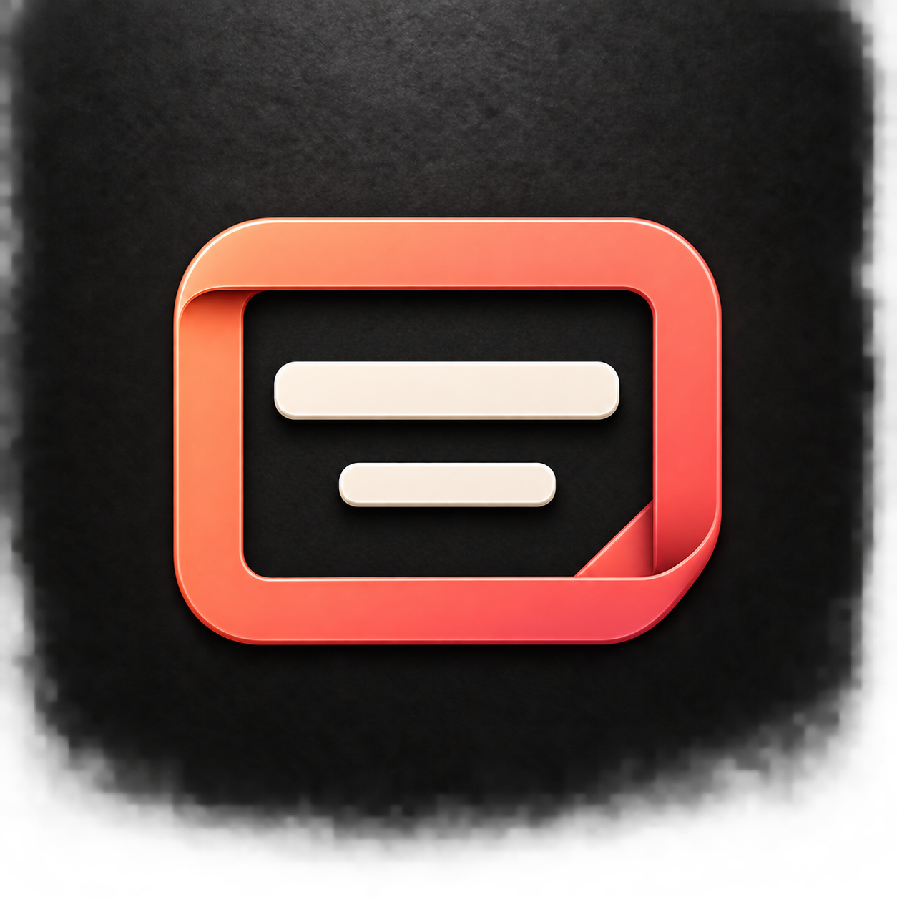

# Slides icon variants

Generated with the built-in image generation tool.

## A — Presentation screen

Prompt: Use case: logo-brand. Create ONE square macOS Slides app icon variant. Reference is for material, lighting and background ONLY; do not reproduce its stacked objects. Exactly one central unified symbol, no overlapping slides or duplicate objects. Match sculpted folded enamel, rounded edges, thin bevel highlights, soft shadows, coral to rose palette, full-bleed textured charcoal background. Front-facing centered composition, generous margins, mark approximately 63% canvas width. No words, watermark, outer app tile or mockup. Subject: a single simple presentation screen on a short integrated central pedestal. Coral enamel rounded landscape rectangular outline with open charcoal interior; inside one ivory horizontal title stroke and a simple ivory rising three-bar chart. Pedestal is part of the same coral structure. Bold minimal silhouette, no extra slides, no folds that resemble a second frame.

## B — Ribbon S

Prompt: Use case: logo-brand. Create ONE square macOS Slides app icon variant. Reference is for material, lighting and background ONLY; do not reproduce its stacked objects. Exactly one central unified symbol, no overlapping slides or duplicate objects. Match sculpted folded enamel, rounded edges, thin bevel highlights, soft shadows, coral to rose palette, full-bleed textured charcoal background. Front-facing centered composition, generous margins, mark approximately 63% canvas width. No words, watermark, outer app tile or mockup. Subject: one large unmistakable uppercase S made of a single continuous wide coral-to-rose folded enamel ribbon. Elegant sweeping curves and two convincing folded turns reveal darker reverse faces. No frame, stand, content bars or other symbols. Strong simple letter silhouette, tactile construction matching the reference's folded edges. The letter S is the entire icon.

## C — Single slide

Prompt: Use case: logo-brand. Create ONE square macOS Slides app icon variant. Reference is for material, lighting and background ONLY; do not reproduce its stacked objects. Exactly one central unified symbol, no overlapping slides or duplicate objects. Match sculpted folded enamel, rounded edges, thin bevel highlights, soft shadows, coral to rose palette, full-bleed textured charcoal background. Front-facing centered composition, generous margins, mark approximately 63% canvas width. No words, watermark, outer app tile or mockup. Subject: exactly one landscape slide, a rounded rectangular frame made of a thick continuous coral enamel ribbon with one subtly folded corner. Open charcoal interior. Inside only one warm ivory horizontal title bar near the top and one smaller ivory horizontal bar below, centered with generous breathing room. No rear frame, no stacked cards, no stand. Extremely clean single-slide symbol.
