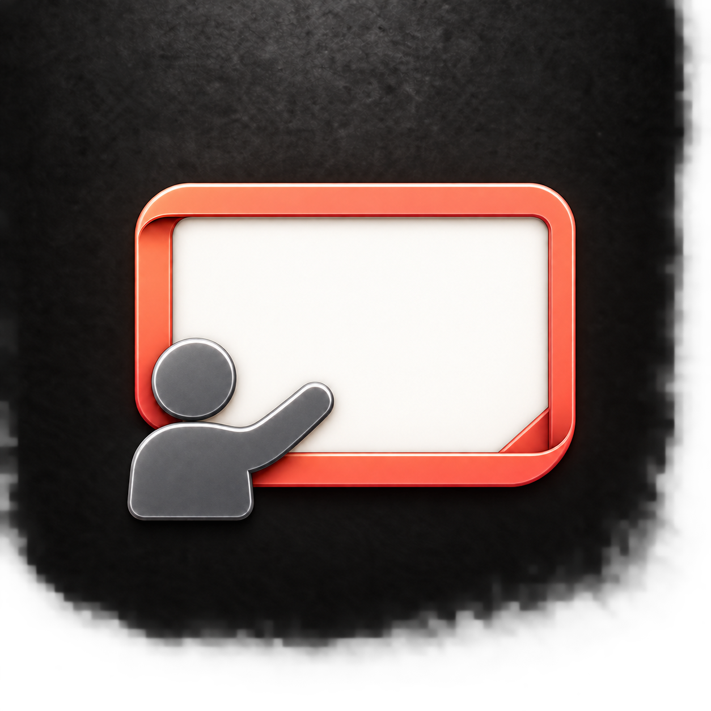

# Charcoal presenter refinements

Generated with the built-in image generation tool. Reference: plan-p3.png. Includes 64-pixel previews.

## P4 — Screen-first

Prompt: Create one refined square macOS Slides icon variant using the supplied P3 image as reference. Preserve its identity: abstract charcoal graphite presenter at lower left gesturing toward a BLANK warm white screen with a coral-rose enamel frame. Keep textured charcoal full-bleed background, premium sculpted enamel, soft top-left lighting, fine silver-gray highlights on the person, subtle depth and shadows. No text, content marks, facial features, fingers, pointer stick, microphones, extra objects or outer app tile. Strong small-size readability. Refinement: make the screen a wider 16:10 landscape shape and reduce the presenter about 15 percent relative to it, keeping the raised arm clearly visible. Use a slightly thinner coral ribbon frame with a restrained folded lower-right corner. More blank white breathing room. Keep the overall composition centered and balanced, occupying 65% of canvas width.

## P5 — Bold gesture

Prompt: Create one refined square macOS Slides icon variant using the supplied P3 image as reference. Preserve its identity: abstract charcoal graphite presenter at lower left gesturing toward a BLANK warm white screen with a coral-rose enamel frame. Keep textured charcoal full-bleed background, premium sculpted enamel, soft top-left lighting, fine silver-gray highlights on the person, subtle depth and shadows. No text, content marks, facial features, fingers, pointer stick, microphones, extra objects or outer app tile. Strong small-size readability. Refinement: slightly enlarge the charcoal presenter and make the raised arm a more clearly bent elbow gesture toward the screen, a simple thick rounded silhouette with no hands or fingers. Keep head separated from shoulder by a small visible gap. The frame stays broad coral with rounded corners, white screen is nearly square landscape 4:3. Strong separation between arm and head. Compact confident pictogram optimized for 32-64 pixels; charcoal person is lighter than background.

## P6 — Quiet satin

Prompt: Create one refined square macOS Slides icon variant using the supplied P3 image as reference. Preserve its identity: abstract charcoal graphite presenter at lower left gesturing toward a BLANK warm white screen with a coral-rose enamel frame. Keep textured charcoal full-bleed background, premium sculpted enamel, soft top-left lighting, fine silver-gray highlights on the person, subtle depth and shadows. No text, content marks, facial features, fingers, pointer stick, microphones, extra objects or outer app tile. Strong small-size readability. Refinement: simplify into a restrained satin-enamel design. A single smoothly rounded coral screen frame of uniform moderate thickness, remove all curled corner folds. Matte warm white screen. Graphite presenter retains original pose and size but has smoother less metallic surfaces, subtle lighter slate top-left shading and clean thin highlights. Reduce deep shadows and glossy specular effects while retaining elegant 3D depth. Clean balanced silhouette, not flat vector art.
