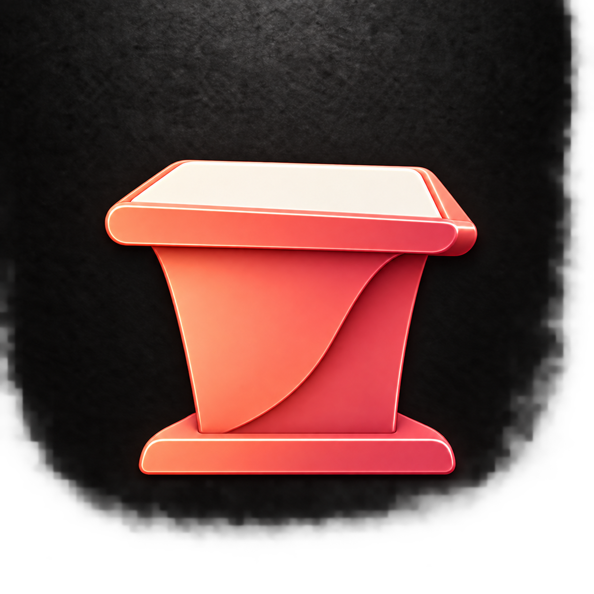
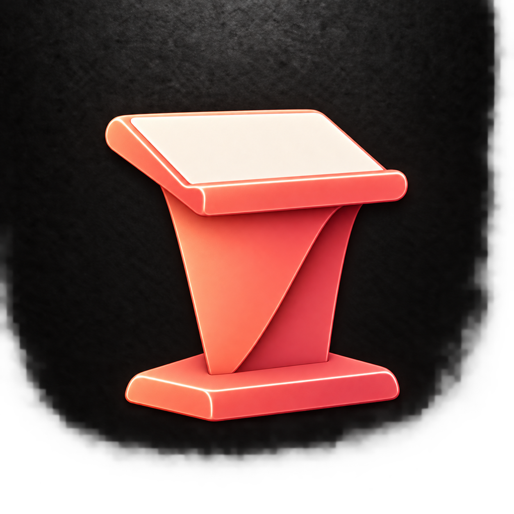
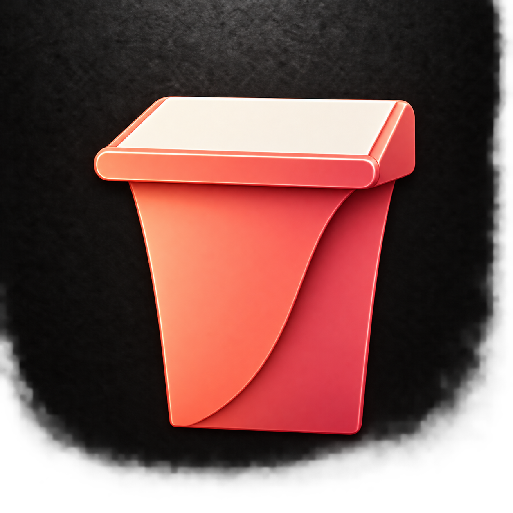

# Podiums without microphones

Generated with the built-in image generation tool. Reference: plan-j.png. Includes 64-pixel previews.

## M — Compact folded lectern

Prompt: Use case: logo-brand. Create one square macOS Slides app icon showing a speaker's lectern WITHOUT ANY MICROPHONE. Reference is for coral-rose sculpted enamel, ivory accents, rounded bevels, folded surfaces, soft top-left light and textured charcoal full-bleed background. One centered unified podium, approximately 62% canvas width and height, balanced margins. Bold silhouette readable at small sizes. No microphone, stem, cable, people, letters, logos, charts, content bars, book, laptop, extra objects or outer app tile. The top is completely unobstructed. Refine the reference by removing the entire microphone and recentering the remaining lectern. Short broad coral tapered front body with a single graceful folded edge, small integrated base, wide ivory slanted reading surface and raised coral front lip. Subtle three-quarter view makes its reading slope visible. Preserve the reference's soft premium curves and compact proportions. Ivory top and coral body are two clear large shapes.

## N — Architectural lectern

Prompt: Use case: logo-brand. Create one square macOS Slides app icon showing a speaker's lectern WITHOUT ANY MICROPHONE. Reference is for coral-rose sculpted enamel, ivory accents, rounded bevels, folded surfaces, soft top-left light and textured charcoal full-bleed background. One centered unified podium, approximately 62% canvas width and height, balanced margins. Bold silhouette readable at small sizes. No microphone, stem, cable, people, letters, logos, charts, content bars, book, laptop, extra objects or outer app tile. The top is completely unobstructed. A modern minimalist lectern made from one thick coral enamel sheet folded into a Z-shaped side profile. Clearly angled ivory reading plane at the top, diagonal solid coral support descending toward a low broad base. Three-quarter side view emphasizes its functional lectern shape and triangular charcoal negative space beneath the reading surface. Crisp simple geometric bends with softened corners, not a letter printed on anything. Strong sculptural silhouette, no ornate pedestal.

## O — Conference podium

Prompt: Use case: logo-brand. Create one square macOS Slides app icon showing a speaker's lectern WITHOUT ANY MICROPHONE. Reference is for coral-rose sculpted enamel, ivory accents, rounded bevels, folded surfaces, soft top-left light and textured charcoal full-bleed background. One centered unified podium, approximately 62% canvas width and height, balanced margins. Bold silhouette readable at small sizes. No microphone, stem, cable, people, letters, logos, charts, content bars, book, laptop, extra objects or outer app tile. The top is completely unobstructed. A solid contemporary conference lectern: wide coral front shield with gently tapering sides, extending directly to the floor without a projecting pedestal base. Broad ivory desktop slopes steeply toward the speaker and has a clearly visible coral retaining lip at its lower edge. Three-quarter frontal view, simple substantial body, one folded-back rose side face creates depth. Rounded upper corners, minimal clean planes, more like a real presentation lectern than a trophy or table.
