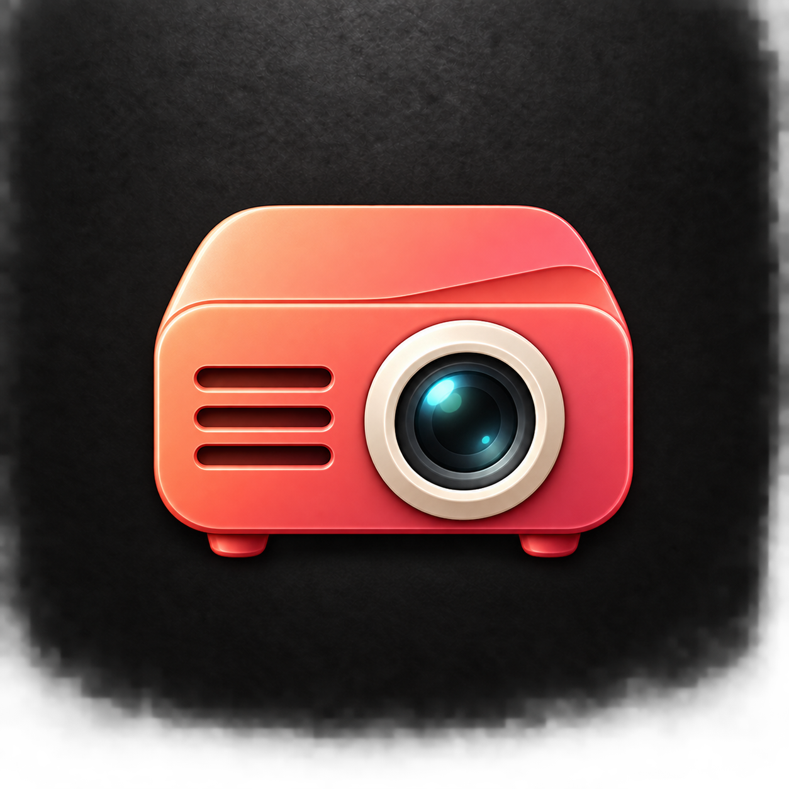

# Presentation-inspired variants

Generated with the built-in image generation tool.

## G — Projector

Prompt: Use case: logo-brand. Create one square macOS app icon for a Slides presentation app. Reference image is a STYLE reference only: match premium tactile coral-to-rose enamel, subtle folded or sculpted surfaces, softly rounded edges, thin bevel highlights, soft top-left lighting and contact shadows on full-bleed subtly textured charcoal. Center one bold unified symbol occupying about 62% of the canvas with generous margins. Simple readable silhouette at small sizes. No letters, text, content bars, charts, play buttons, watermark, outer app tile, or scene with multiple objects. Subject: a beautifully simplified presentation projector, one compact coral rounded rectangular body viewed slightly from above and front. One prominent warm ivory circular lens bezel with a deep dark glass lens, subtle cyan lens reflection, placed slightly right of center. A few understated recessed ventilation slots on the left and two tiny integrated feet. The lens is the visual focus. No projected beam, no screen, no cables or room. Sculpted minimal hardware, not a detailed product photograph.

## H — Podium

Prompt: Use case: logo-brand. Create one square macOS app icon for a Slides presentation app. Reference image is a STYLE reference only: match premium tactile coral-to-rose enamel, subtle folded or sculpted surfaces, softly rounded edges, thin bevel highlights, soft top-left lighting and contact shadows on full-bleed subtly textured charcoal. Center one bold unified symbol occupying about 62% of the canvas with generous margins. Simple readable silhouette at small sizes. No letters, text, content bars, charts, play buttons, watermark, outer app tile, or scene with multiple objects. Subject: an elegant speaker's lectern / presentation podium, one sculptural coral ribbon forming a broad slanted top, a tapering central upright and a stable curved base. Warm ivory top surface visible at a slight angle. One minimal slender gooseneck microphone curves up from the top, integrated into the composition. Mostly frontal, strong balanced silhouette. Modern clean lectern rather than a classical column. No speaker, no audience, no emblem or writing. Rich folded enamel construction.

## I — Projection screen

Prompt: Use case: logo-brand. Create one square macOS app icon for a Slides presentation app. Reference image is a STYLE reference only: match premium tactile coral-to-rose enamel, subtle folded or sculpted surfaces, softly rounded edges, thin bevel highlights, soft top-left lighting and contact shadows on full-bleed subtly textured charcoal. Center one bold unified symbol occupying about 62% of the canvas with generous margins. Simple readable silhouette at small sizes. No letters, text, content bars, charts, play buttons, watermark, outer app tile, or scene with multiple objects. Subject: a classic pull-down projection screen, an elegant blank warm ivory landscape screen hanging from a thick coral top roller bar. A coral lower rail and one short centered pull tab give a recognizable projection-screen silhouette. The lower-right ivory edge curls gently to reveal a rose underside, adding the family's folded detail. Screen ratio about 4:3, not a monitor. No pedestal, no tripod, no picture, no content, no surrounding room. One unified minimal object with broad clean surfaces.
