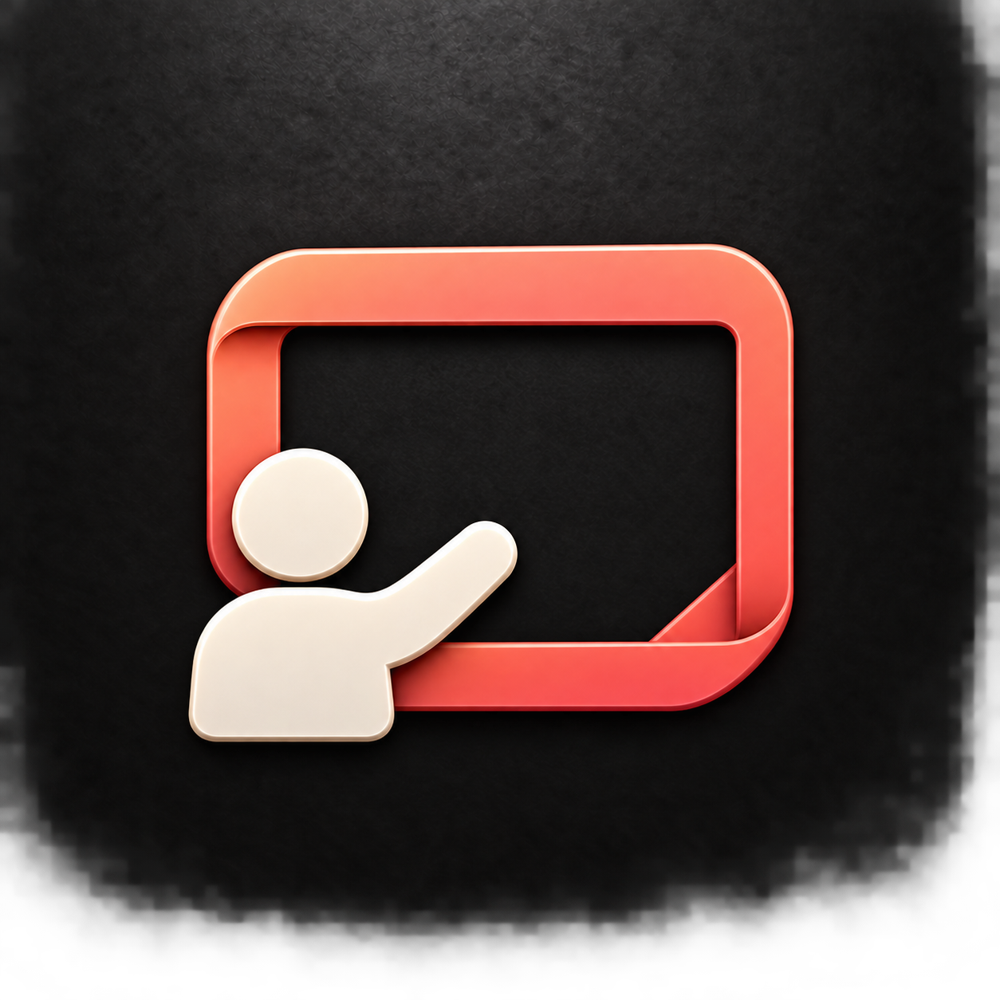

# Presenter variants

Generated with the built-in image generation tool. Includes 64-pixel previews.

## P — Presenter beside screen

Prompt: Use case: logo-brand. Create one square macOS Slides app icon. Reference is STYLE ONLY: coral-rose sculpted enamel, ivory accents, subtly folded surfaces, softly rounded bevels, thin edge highlights, soft top-left lighting and shadows, full-bleed textured charcoal background. New presentation concept, bold unified silhouette legible at 32–64 px. Centered composition fills about 65% canvas with generous margins. No words, letters, content bars, charts, microphone, podium, watermark, outer app tile or realistic scene. Abstract people must be simple round head and solid torso, no facial features, hands or fingers. One integrated presentation pictogram: a large single coral landscape screen outline, open charcoal inside, with a warm ivory abstract presenter at the lower left. The presenter has a round head, a compact broad torso and one thick raised arm gesturing toward the screen. Figure overlaps only the lower-left corner so the screen remains clearly readable. No thin pointer stick, no tiny details, no legs. Clean purposeful asymmetry and strong ivory/coral contrast.

## Q — Presenter in front

Prompt: Use case: logo-brand. Create one square macOS Slides app icon. Reference is STYLE ONLY: coral-rose sculpted enamel, ivory accents, subtly folded surfaces, softly rounded bevels, thin edge highlights, soft top-left lighting and shadows, full-bleed textured charcoal background. New presentation concept, bold unified silhouette legible at 32–64 px. Centered composition fills about 65% canvas with generous margins. No words, letters, content bars, charts, microphone, podium, watermark, outer app tile or realistic scene. Abstract people must be simple round head and solid torso, no facial features, hands or fingers. One iconic presentation pictogram: a broad coral rounded landscape screen with a subtly recessed rose face, behind a centered warm ivory bust of a presenter. A large simple circular head and broad curved shoulder shape overlap the screen's bottom edge. Screen and presenter form one compact silhouette. No arms, legs, content or additional people. Human figure modest in size so the large screen unmistakably remains the setting. Sculpted folded edges on the screen, minimal geometry.

## R — Presentation spotlight

Prompt: Use case: logo-brand. Create one square macOS Slides app icon. Reference is STYLE ONLY: coral-rose sculpted enamel, ivory accents, subtly folded surfaces, softly rounded bevels, thin edge highlights, soft top-left lighting and shadows, full-bleed textured charcoal background. New presentation concept, bold unified silhouette legible at 32–64 px. Centered composition fills about 65% canvas with generous margins. No words, letters, content bars, charts, microphone, podium, watermark, outer app tile or realistic scene. Abstract people must be simple round head and solid torso, no facial features, hands or fingers. An abstract speaker on a presentation stage: a small warm ivory human silhouette (round head, single solid tapered torso) centered inside a broad coral landscape rectangular screen frame. The upper-left corner of the frame folds inward into a single broad softly shaded ivory triangular spotlight wedge aimed toward the figure, suggesting presenting to an audience. Keep the wedge restrained so the human silhouette remains distinct. Screen, light and figure compose one simple emblem, no separate lamps, no audience, no scenery. Bold clean negative space, no fine details.
