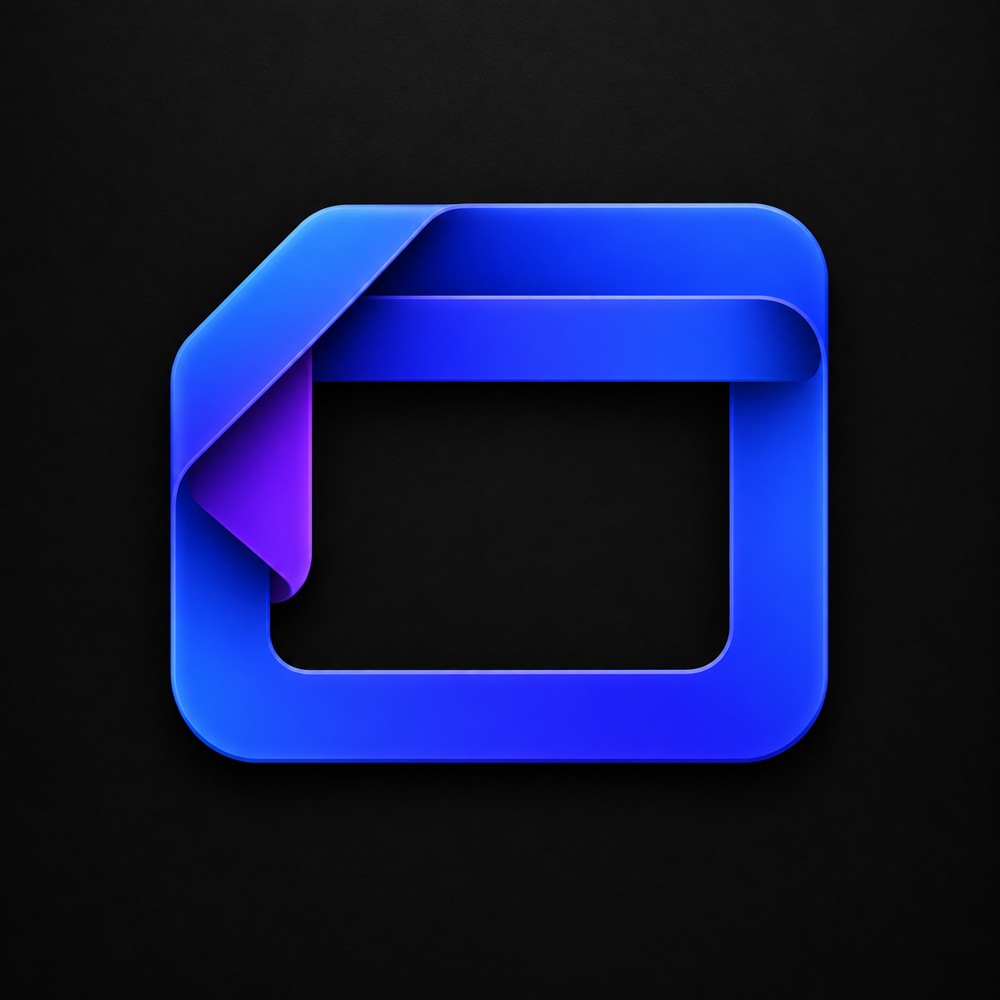
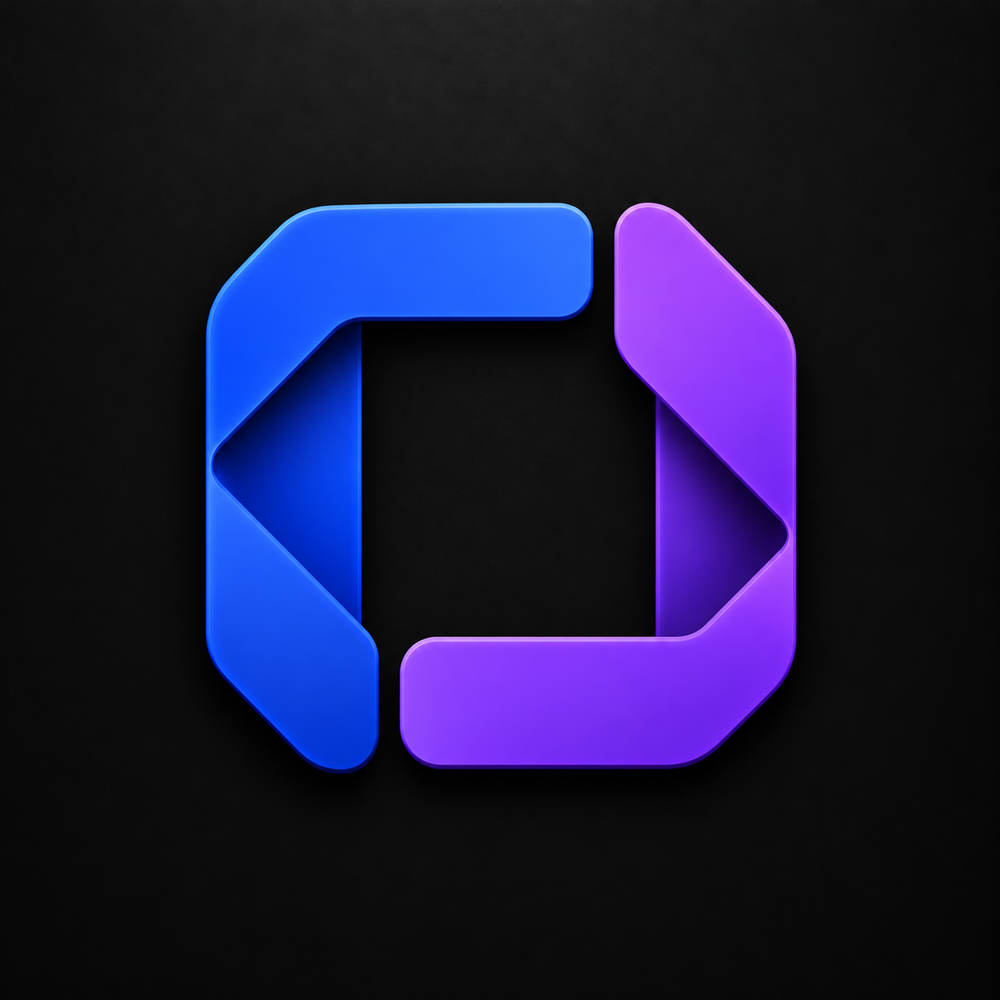
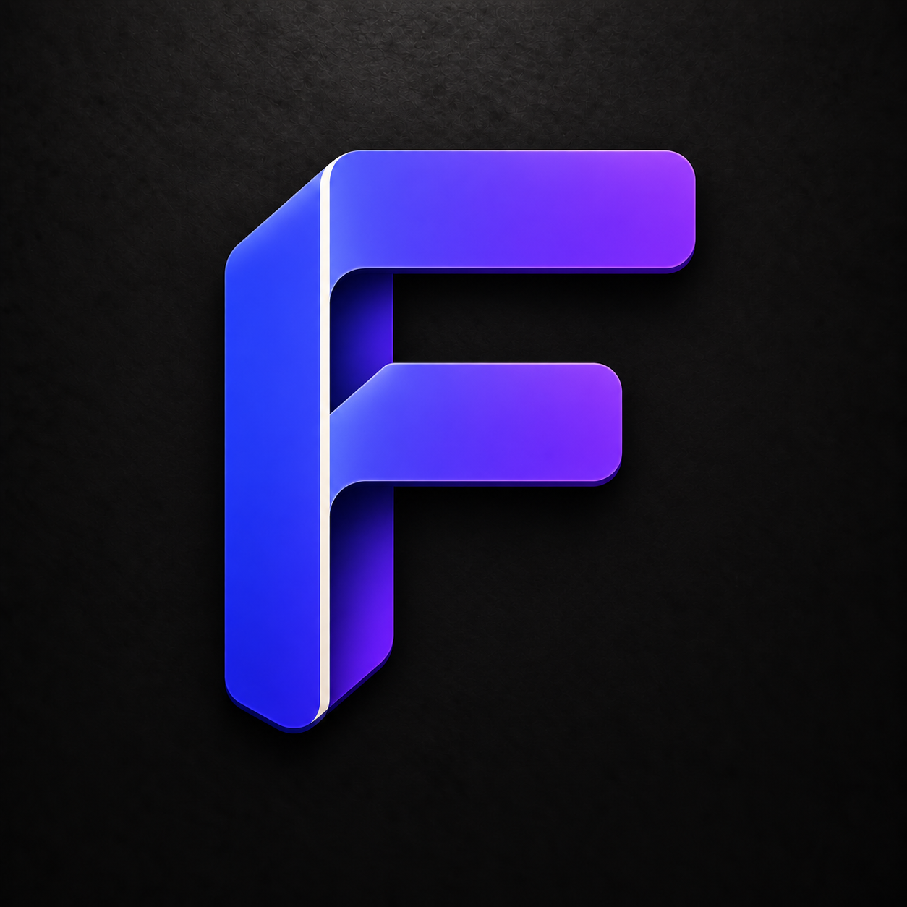

# Legend Frame logo concepts

Generated with the built-in image generation tool. Style reference: apps/code/assets/code-icon.png.

## A — Folded window

Prompt: Use case: logo-brand. Generate one logo mark concept for Legend Frame, a framework for building desktop applications. Supplied image is a family STYLE reference only, not subject: premium sculpted folded ribbons, rounded bevels, restrained highlights and subtle dimensional shadows. Logo must have a simple distinctive geometric silhouette that could later translate into a flat vector. Square composition, centered mark occupying 60–65% of canvas, full-bleed opaque near-black charcoal background with only very subtle texture. All outer edges opaque black, no transparency. Restrained electric indigo to violet palette with optional ivory accent. No words, slogan, watermark, device mockup, code brackets or tiny details. A single continuous wide indigo ribbon bends into a softly rounded landscape desktop-window frame, with an elegant folded upper-left corner revealing a violet reverse. One thin integrated horizontal crosspiece near the top suggests a desktop window title bar. Large clean empty center. No window buttons, no content. Distinctive compact frame with tactile folded construction, a symbol for the foundation around an application.

## B — Interlocking corners

Prompt: Use case: logo-brand. Generate one logo mark concept for Legend Frame, a framework for building desktop applications. Supplied image is a family STYLE reference only, not subject: premium sculpted folded ribbons, rounded bevels, restrained highlights and subtle dimensional shadows. Logo must have a simple distinctive geometric silhouette that could later translate into a flat vector. Square composition, centered mark occupying 60–65% of canvas, full-bleed opaque near-black charcoal background with only very subtle texture. All outer edges opaque black, no transparency. Restrained electric indigo to violet palette with optional ivory accent. No words, slogan, watermark, device mockup, code brackets or tiny details. Two bold complementary L-shaped structural pieces interlock to form one nearly square open frame. Upper-left piece electric indigo, lower-right piece violet. Small carefully placed gaps at the two joints communicate modular assembly. Folded ribbon depth at the corners, rounded ends, broad clean charcoal negative-space center. One cohesive symmetrical symbol for composable desktop software, no nested frames or extra objects.

## C — Window F

Prompt: Use case: logo-brand. Generate one logo mark concept for Legend Frame, a framework for building desktop applications. Supplied image is a family STYLE reference only, not subject: premium sculpted folded ribbons, rounded bevels, restrained highlights and subtle dimensional shadows. Logo must have a simple distinctive geometric silhouette that could later translate into a flat vector. Square composition, centered mark occupying 60–65% of canvas, full-bleed opaque near-black charcoal background with only very subtle texture. All outer edges opaque black, no transparency. Restrained electric indigo to violet palette with optional ivory accent. No words, slogan, watermark, device mockup, code brackets or tiny details. An abstract uppercase F formed from a single folded indigo-violet ribbon with two open rectangular window-like bays. Strong vertical spine, long top crossbar, shorter middle crossbar, clean right-angle turns softened at corners. The geometry should evoke desktop window frames and an architectural framework while still reading as a unique F monogram. One ivory inner edge accent only if needed. Bold minimal silhouette, no literal UI content or extra floating pieces.
