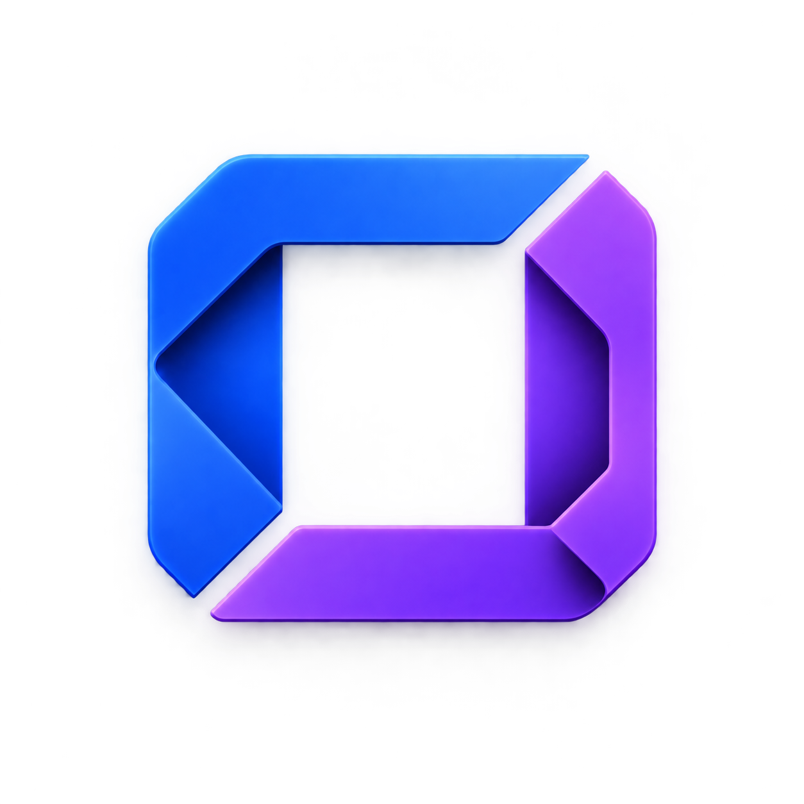

# Legend Frame corner variants

Generated with the built-in image tool using plan-b.png as reference.

## B1 — Clean miters

Prompt: Use case: logo-brand. Create a refined variant of the attached Legend Frame logo, a desktop app framework. Reference image supplies blue/violet palette, sculpted folded-ribbon finish, centered square framing and opaque near-black background. IMPORTANT geometry change: exactly TWO L pieces: blue TOP + LEFT edges connected seamlessly at TOP LEFT; violet BOTTOM + RIGHT edges connected seamlessly at BOTTOM RIGHT. Exactly TWO black diagonal gaps, located precisely at the TOP RIGHT corner and BOTTOM LEFT corner, cutting across each corner at 45 degrees. No gaps along the straight horizontal or vertical stretches. Open square black center. Broad ribbons, balanced 180-degree rotational geometry. Preserve premium bevels and restrained highlights, readable simple silhouette. One mark only, no text, labels or extra elements, full opaque black outer edges. Make the two open corners precise narrow diagonal miter seams. Simplify folds to subtle dimensional bends at the closed top-left and bottom-right corners. Broad flat faces and softly rounded outline, clean architectural construction.

## B2 — Folded corners

Prompt: Use case: logo-brand. Create a refined variant of the attached Legend Frame logo, a desktop app framework. Reference image supplies blue/violet palette, sculpted folded-ribbon finish, centered square framing and opaque near-black background. IMPORTANT geometry change: exactly TWO L pieces: blue TOP + LEFT edges connected seamlessly at TOP LEFT; violet BOTTOM + RIGHT edges connected seamlessly at BOTTOM RIGHT. Exactly TWO black diagonal gaps, located precisely at the TOP RIGHT corner and BOTTOM LEFT corner, cutting across each corner at 45 degrees. No gaps along the straight horizontal or vertical stretches. Open square black center. Broad ribbons, balanced 180-degree rotational geometry. Preserve premium bevels and restrained highlights, readable simple silhouette. One mark only, no text, labels or extra elements, full opaque black outer edges. Retain pronounced folded-ribbon turns at closed top-left and bottom-right corners, revealing darker reverse surfaces. At the open top-right and bottom-left corners the two ribbon ends are diagonally cut and separated by a clear small black gap. Elegant origami structure, strong visual depth.

## B3 — Soft joins

Prompt: Use case: logo-brand. Create a refined variant of the attached Legend Frame logo, a desktop app framework. Reference image supplies blue/violet palette, sculpted folded-ribbon finish, centered square framing and opaque near-black background. IMPORTANT geometry change: exactly TWO L pieces: blue TOP + LEFT edges connected seamlessly at TOP LEFT; violet BOTTOM + RIGHT edges connected seamlessly at BOTTOM RIGHT. Exactly TWO black diagonal gaps, located precisely at the TOP RIGHT corner and BOTTOM LEFT corner, cutting across each corner at 45 degrees. No gaps along the straight horizontal or vertical stretches. Open square black center. Broad ribbons, balanced 180-degree rotational geometry. Preserve premium bevels and restrained highlights, readable simple silhouette. One mark only, no text, labels or extra elements, full opaque black outer edges. Use slightly wider diagonal gaps exactly across top-right and bottom-left corners, with softly rounded cut ends that face one another. The continuous top-left and bottom-right L corners are smooth curved sculptural bends. Slightly thicker ribbon, minimal folds, tactile satin material, exceptionally clear compact silhouette.
