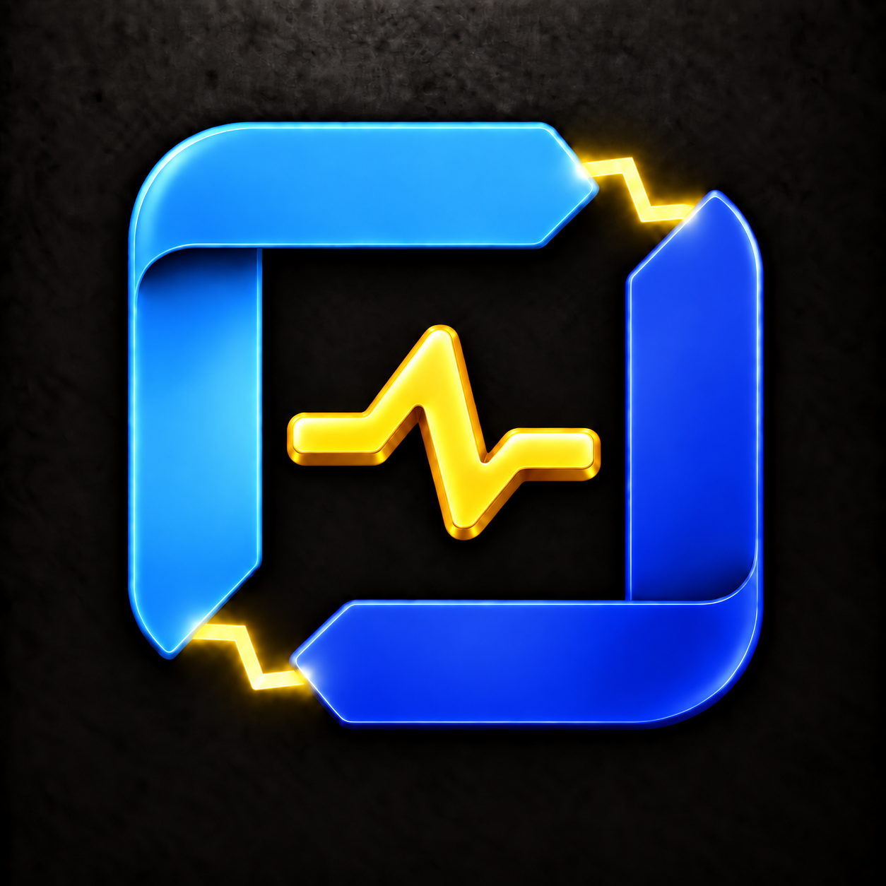
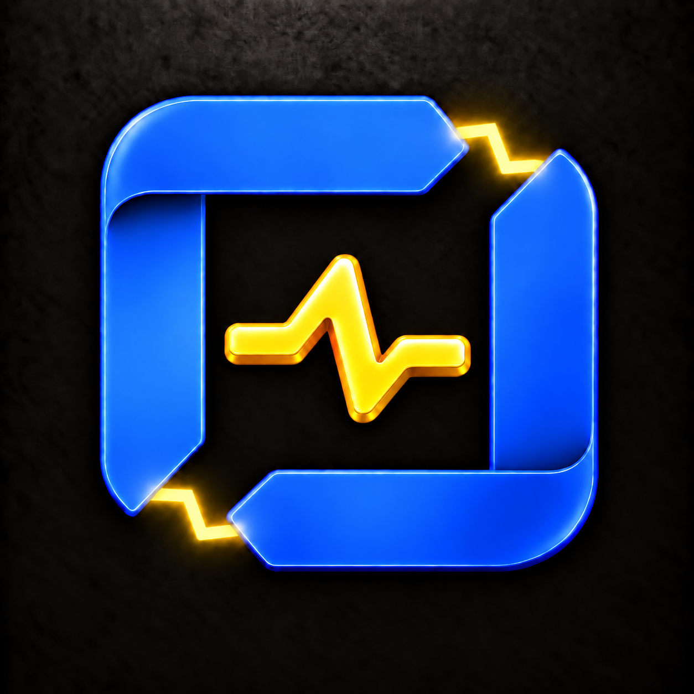
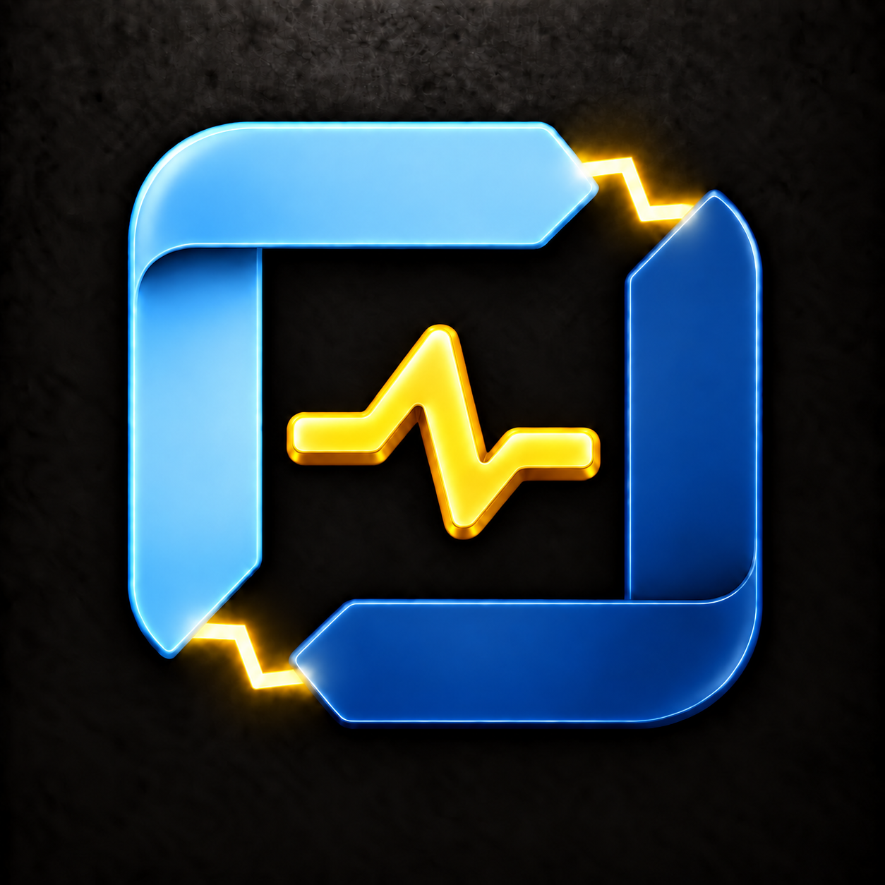
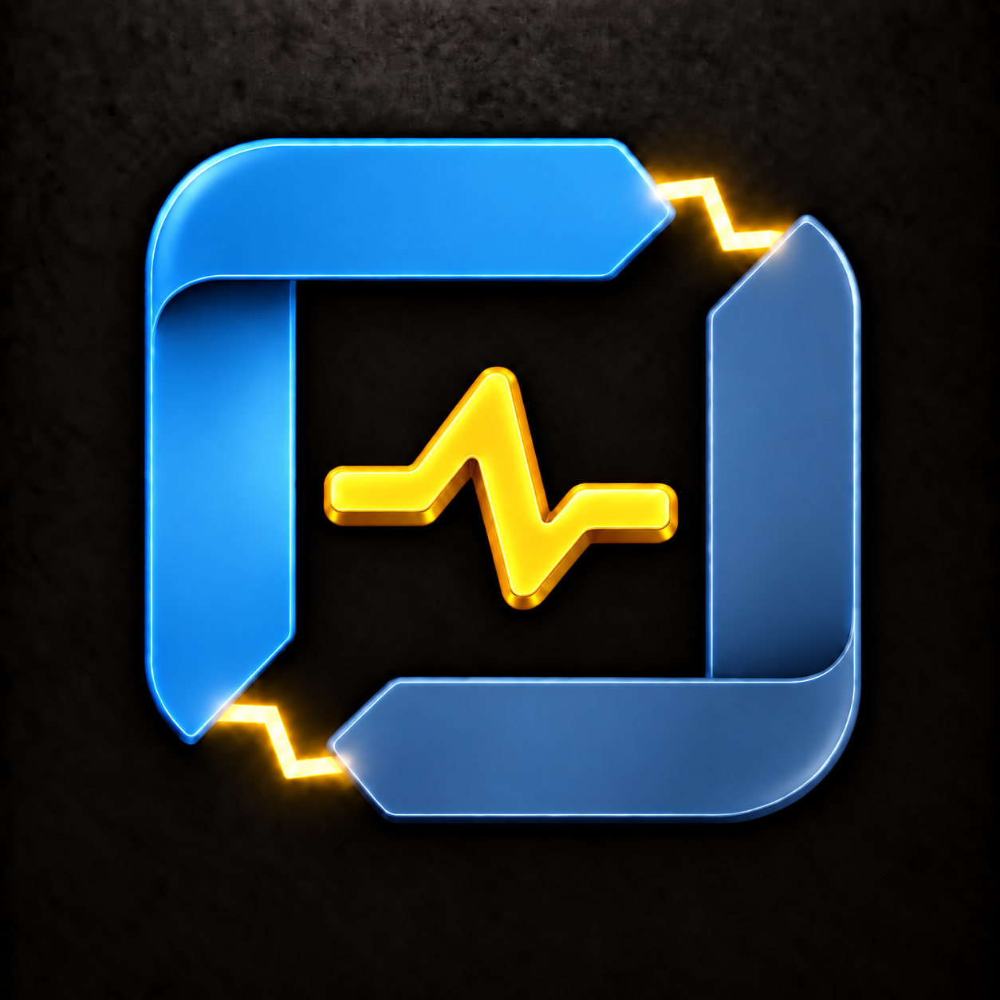

# Legend Spark blue and yellow variants

Generated with the built-in image tool. Reference: plan-h1a.png.

## H1A1 — Sky / cobalt

Prompt: Use case: precise-object-edit. Recolor ONLY attached Legend Spark icon. Preserve exact geometry, scale, folds, bevels, placement, black textured opaque background and lighting. Two folded L pieces, electrical bridges at top-right and bottom-left, centered horizontal pulse. IMPORTANT: center pulse must be vivid golden YELLOW enamel with amber sidewalls, not white or blue. Both electrical corner bridges are bright YELLOW with subtle warm golden glow. Keep these identical across palette variants. Only change the blue frame colors as specified. No new elements, no transparency, black outer edges. Upper-left L is clear saturated sky blue (#29A9FF), lower-right L rich cobalt (#2452E8). Strong blue-on-blue contrast, no teal or purple.

## H1A2 — Electric blue

Prompt: Use case: precise-object-edit. Recolor ONLY attached Legend Spark icon. Preserve exact geometry, scale, folds, bevels, placement, black textured opaque background and lighting. Two folded L pieces, electrical bridges at top-right and bottom-left, centered horizontal pulse. IMPORTANT: center pulse must be vivid golden YELLOW enamel with amber sidewalls, not white or blue. Both electrical corner bridges are bright YELLOW with subtle warm golden glow. Keep these identical across palette variants. Only change the blue frame colors as specified. No new elements, no transparency, black outer edges. Both L pieces use the SAME saturated electric royal blue (#2475F5), differentiated only by natural shading and folds. A unified blue frame, no cyan, teal or purple.

## H1A3 — Ice / navy

Prompt: Use case: precise-object-edit. Recolor ONLY attached Legend Spark icon. Preserve exact geometry, scale, folds, bevels, placement, black textured opaque background and lighting. Two folded L pieces, electrical bridges at top-right and bottom-left, centered horizontal pulse. IMPORTANT: center pulse must be vivid golden YELLOW enamel with amber sidewalls, not white or blue. Both electrical corner bridges are bright YELLOW with subtle warm golden glow. Keep these identical across palette variants. Only change the blue frame colors as specified. No new elements, no transparency, black outer edges. Upper-left L is soft luminous ice blue (#85C9F5), lower-right L deep sapphire navy (#174A99), clearly visible on black. Elegant strong light-dark contrast, no purple.

## H1A4 — Azure / steel

Prompt: Use case: precise-object-edit. Recolor ONLY attached Legend Spark icon. Preserve exact geometry, scale, folds, bevels, placement, black textured opaque background and lighting. Two folded L pieces, electrical bridges at top-right and bottom-left, centered horizontal pulse. IMPORTANT: center pulse must be vivid golden YELLOW enamel with amber sidewalls, not white or blue. Both electrical corner bridges are bright YELLOW with subtle warm golden glow. Keep these identical across palette variants. Only change the blue frame colors as specified. No new elements, no transparency, black outer edges. Upper-left L is medium azure blue (#238CDC), lower-right L muted slate steel blue (#426B9A). Restrained sophisticated blue palette, less neon, bright yellow pulse still prominent. No teal, purple or gray frame.
