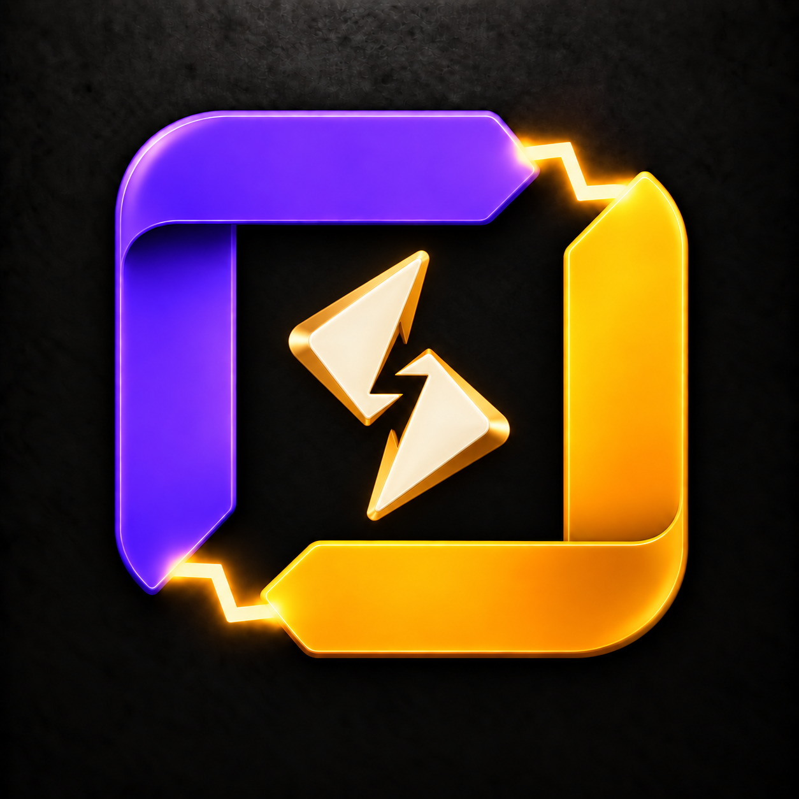

# Legend Spark center variants

Generated with the built-in image tool. Reference: plan-h.png.

## H1 — Pulse

Prompt: Use case: precise-object-edit. Edit the attached Legend Spark H icon. KEEP the outer frame precisely unchanged: violet folded top/left L, amber folded bottom/right L, glowing zigzag electrical bridges at top-right and bottom-left gaps. Preserve scale, composition, materials, lighting and opaque black textured background. Only ADD a compact abstract electrical ignition symbol centered in the empty black interior, occupying about 45% of the interior width/height with ample separation from the frame. Ivory enamel with warm gold reverse edges, matching sculpted ribbon depth. No four-point sparkle, no Gemini star, no flame or Firebase shapes, no text or letters, no particles, no additional changes. Center symbol: a single thick sculpted horizontal electrical pulse ribbon, short level lead-in, one sharp asymmetric rising peak followed by a short deep notch then level lead-out. Three angular bends total, softened bevel edges, compact dynamic zigzag energy rather than a conventional vertical lightning bolt. Very simple silhouette.

## H2 — Charged shards

Prompt: Use case: precise-object-edit. Edit the attached Legend Spark H icon. KEEP the outer frame precisely unchanged: violet folded top/left L, amber folded bottom/right L, glowing zigzag electrical bridges at top-right and bottom-left gaps. Preserve scale, composition, materials, lighting and opaque black textured background. Only ADD a compact abstract electrical ignition symbol centered in the empty black interior, occupying about 45% of the interior width/height with ample separation from the frame. Ivory enamel with warm gold reverse edges, matching sculpted ribbon depth. No four-point sparkle, no Gemini star, no flame or Firebase shapes, no text or letters, no particles, no additional changes. Center symbol: two chunky tapered ivory-gold angular shards angled toward one another from upper-left and lower-right, with a narrow diagonal black zigzag slit between their tips suggesting a discharge. Two pieces form one compact abstract ignition mark, rotationally balanced, no star silhouette, no diamond ring. Clean sculpted folded facets.

## H3 — Angular burst

Prompt: Use case: precise-object-edit. Edit the attached Legend Spark H icon. KEEP the outer frame precisely unchanged: violet folded top/left L, amber folded bottom/right L, glowing zigzag electrical bridges at top-right and bottom-left gaps. Preserve scale, composition, materials, lighting and opaque black textured background. Only ADD a compact abstract electrical ignition symbol centered in the empty black interior, occupying about 45% of the interior width/height with ample separation from the frame. Ivory enamel with warm gold reverse edges, matching sculpted ribbon depth. No four-point sparkle, no Gemini star, no flame or Firebase shapes, no text or letters, no particles, no additional changes. Center symbol: a compact asymmetric three-pronged electrical burst made from one continuous folded ivory ribbon. Three short chunky tapered arms kick outward at irregular angles from a solid offset hub, like an abstract snapping spark. Angular lively silhouette, one gold underside fold, no radial symmetry, no four-point star, no circular hub or spinner.
