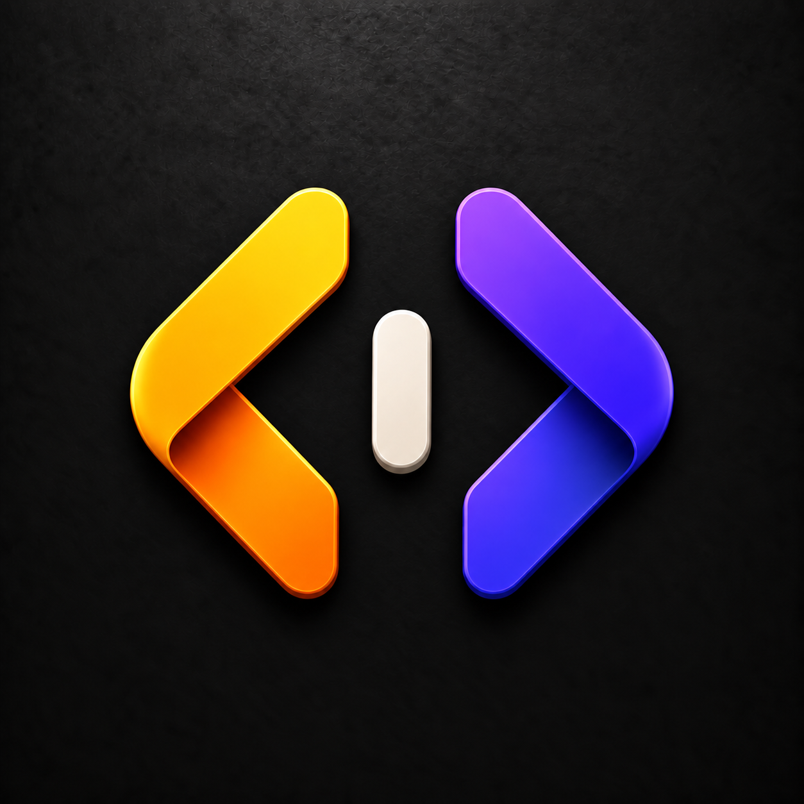
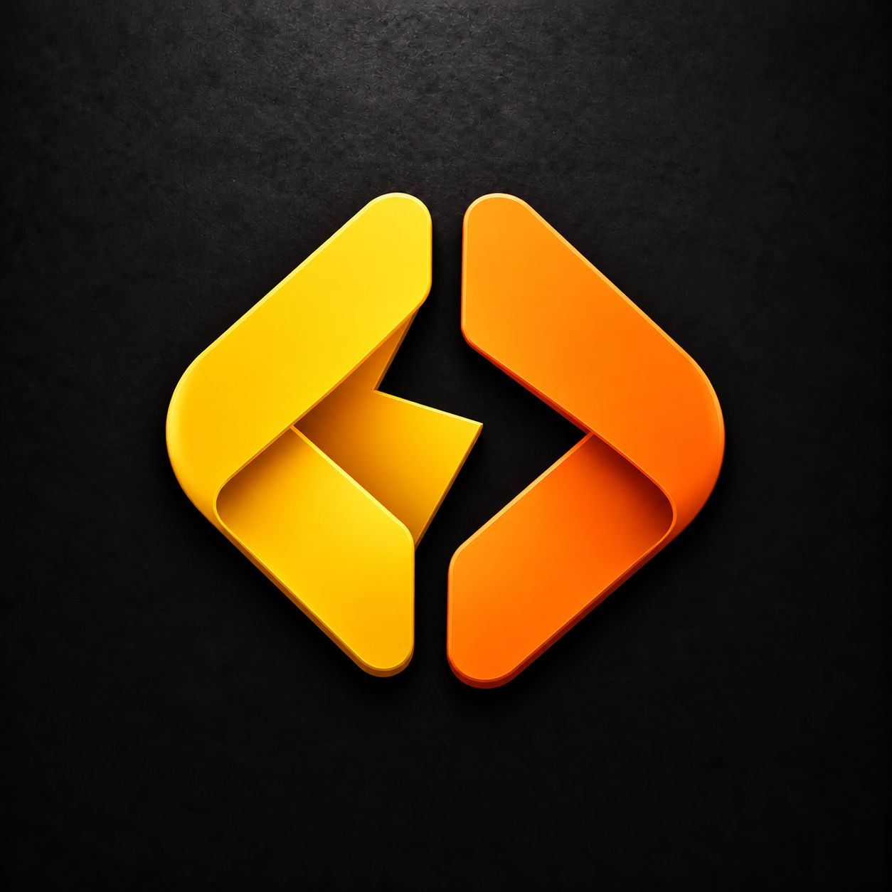
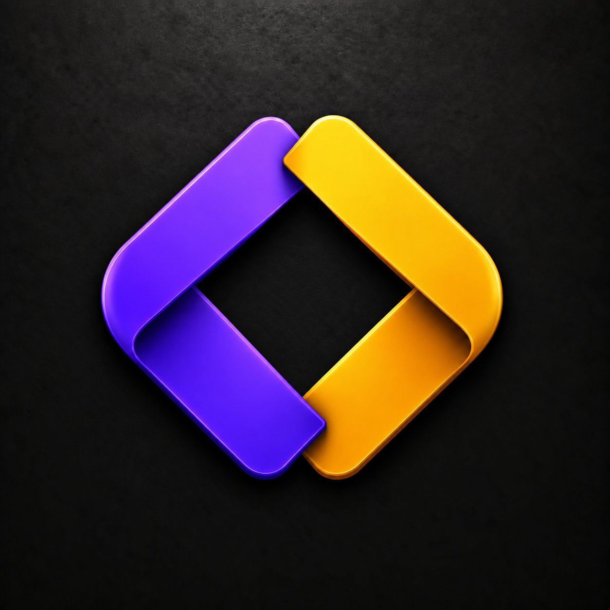

# Legend Spark code-symbol variants

Generated with the built-in image tool. Reference: apps/code/assets/code-icon.png.

## E — Amber brackets

Prompt: Use case: logo-brand. Generate a square Legend Spark desktop framework icon using recognizable less-than and greater-than code brackets <> as the primary subject. Attached Code icon is the family style reference: sculpted folded enamel ribbons, rounded bevels, subtle depth and shadows, full-bleed opaque near-black lightly textured background. Match its polish but create a distinct mark. Centered bold compact silhouette filling about 78% width. Black all outer edges, no transparency. NO four-point stars, sparkles, flames, Firebase-like shapes, Gemini-like shapes, words, letters, UI content or extra decorative particles. Exactly two broad folded angle brackets, left < in warm amber gold with orange reverse and right > in electric indigo violet. Between them a single short upright ivory lozenge representing a point of ignition, substantially shorter than the brackets. No diagonal slash. Symmetrical balanced overall layout. Keep each bracket unmistakably readable, rich clean surfaces.

## F — Lightning gap

Prompt: Use case: logo-brand. Generate a square Legend Spark desktop framework icon using recognizable less-than and greater-than code brackets <> as the primary subject. Attached Code icon is the family style reference: sculpted folded enamel ribbons, rounded bevels, subtle depth and shadows, full-bleed opaque near-black lightly textured background. Match its polish but create a distinct mark. Centered bold compact silhouette filling about 78% width. Black all outer edges, no transparency. NO four-point stars, sparkles, flames, Firebase-like shapes, Gemini-like shapes, words, letters, UI content or extra decorative particles. Exactly two folded code brackets, a golden yellow < on the left and orange > on the right. Bring them close together and offset their inside ends slightly so the narrow BLACK NEGATIVE SPACE between them forms a sharp zigzag lightning channel. There is NO separate lightning bolt object. Two pieces only. Strong broad folded bands, clever simple negative-space logo, open at top and bottom, still immediately reads as <>.

## G — Interlocking code

Prompt: Use case: logo-brand. Generate a square Legend Spark desktop framework icon using recognizable less-than and greater-than code brackets <> as the primary subject. Attached Code icon is the family style reference: sculpted folded enamel ribbons, rounded bevels, subtle depth and shadows, full-bleed opaque near-black lightly textured background. Match its polish but create a distinct mark. Centered bold compact silhouette filling about 78% width. Black all outer edges, no transparency. NO four-point stars, sparkles, flames, Firebase-like shapes, Gemini-like shapes, words, letters, UI content or extra decorative particles. Two compact folded code brackets <> interlock through one subtle over-under overlap at their inner upper and lower ends, making a cohesive nearly diamond-shaped open emblem. Left bracket electric violet, right bracket amber gold, dark reverse surfaces. Preserve a clear black central opening and recognizable outward-pointing < and >. Minimal two-piece construction, broad smooth ribbon faces, tight geometric silhouette, no central slash or additional object.
